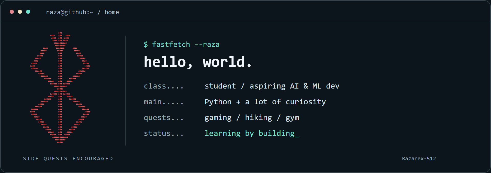
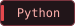
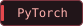
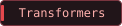
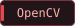
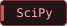

<picture>
  <source media="(max-width: 600px)" srcset="assets/terminal-mobile-revolve.gif">
  
</picture>

# hey, I'm Raza 👋

Student at UCalgary, aspiring AI/ML dev, and someone who likes figuring things out by building them.

Right now, that means experimenting with language models, teaching a camera to make sense of a room, and digging into what makes model inference faster. Outside of code, you'll find me gaming, hiking, or at the gym.

[portfolio ↗](https://www.razabuilds.dev/) · [linkedin ↗](https://ca.linkedin.com/in/syed-muhammad-mehdi-raza) · [say hello ↗](mailto:syed.syed1@ucalgary.ca)

## ~/projects

### 🧠 Do language models treat everyone the same?

I tested **Phi-2, StableLM-3B, and TinyLlama** on 96 chest-pain vignettes, changing demographic details to see how their answers shifted. An academic exploration of model fairness, with code, outputs, and charts you can dig into.

  

[the experiments →](https://github.com/Razarex-512/Razarex-512-Bias-and-fairness-analysis-in-LLMs-for-heart-attack-triage) · [the results →](https://github.com/Razarex-512/Razarex-512-Bias-and-fairness-analysis-in-LLMs-for-heart-attack-triage/tree/main/results)

### 👁️ One camera. A little sense of space.

Building **monocular visual SLAM**: tracking landmarks, mapping a scene, and finding the way back to places the camera has seen before. There's also a pretrained depth model for visualizing relative distance. Synthetic tests are in; real indoor accuracy is still on the to-do list.

   

[look around the code →](https://github.com/Razarex-512/SLAM-project)

### 🤖 Tiny decoder language model.

I built a tiny **decoder-only chatbot from scratch in PyTorch** to learn how tokenization, attention, training, and autoregressive text generation work. Trained on a fictional campus FAQ, it runs on CPU with **438,272 parameters**. A learning project with plenty still to improve on unfamiliar questions.

 

[take a look at the code →](https://github.com/Razarex-512/Decoder-only-chatbot)

### ⚡ Currently tinkering with…

A PyTorch inference benchmark: **CPU vs. GPU**, latency, throughput, and the trade-offs behind running smaller models. Still a work in progress.

 

## ~/toolbox

**AI / ML** · PyTorch, TensorFlow, Hugging Face Transformers, NLP, model evaluation  
**Code** · Python, Java, JavaScript, C++, C#, SQL  
**Backend** · Node.js, Express, REST APIs, PostgreSQL, MySQL  
**Everyday tools** · Git, Docker, Linux, PowerShell

A little more about me

My full name is **Syed Muhammad Mehdi Raza**. I'm pursuing a BSc in Natural Science with a Computer Science concentration at the University of Calgary, through the Science Co-op Program.

I also run **RnP Automations**, where I've built B2B automation and AI tools, integration pipelines, and monitoring workflows.

---

Open to **AI/ML and software engineering internships or co-ops**. Building something interesting? [Let's talk.](mailto:syed.syed1@ucalgary.ca)
